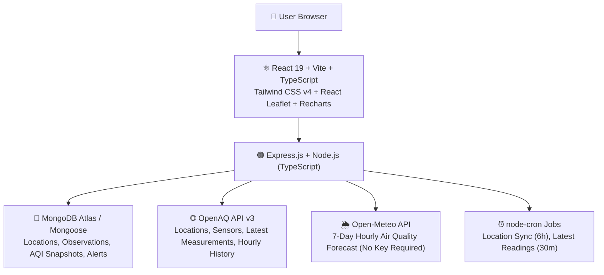

# BreatheBetter — Real-Time Air Quality Intelligence Platform

> **Tagline:** Know Your Air. Protect Your Health.  
> **Challenge:** Lets Code Diwali Challenge 2026 — Breathe Better  
> **Scope:** India-first, extensible to global locations  

---

## 🌟 Overview

**BreatheBetter** is a full-stack, production-quality Air Quality Intelligence Platform designed to monitor real-time air pollution across Indian cities and monitoring stations. 

Unlike basic dashboards that display raw numbers, BreatheBetter collects authentic air-quality measurements from **OpenAQ v3**, integrates 7-day modelled forecasts from **Open-Meteo**, computes mathematically verified AQI using **India's CPCB National AQI methodology**, tracks historical trends, and delivers actionable, public-health-grounded guidance.

---

## 🏗️ Architecture & Technology Stack



### Frontend
- **Framework:** React 19 with Vite & TypeScript
- **Styling:** Tailwind CSS v4 with dark mode & CPCB severity palette
- **Interactive Maps:** Leaflet & React Leaflet (vector CircleMarkers with CPCB colors)
- **Charts & Trends:** Recharts (PM2.5, PM10, NO₂, SO₂, CO, O₃)
- **State & Caching:** TanStack React Query + Zustand (with localStorage persistence)
- **Icons:** Lucide React

### Backend
- **Framework:** Node.js + Express.js with TypeScript
- **Database:** MongoDB Atlas via Mongoose (with in-memory fixture fallback mode)
- **Validation:** Zod schemas
- **External Providers:**
  - OpenAQ API v3 (`/locations`, `/latest`, `/sensors`, `/sensors/{id}/hours`)
  - Open-Meteo Air Quality Forecast API (7-day hourly projections)
- **Scheduler:** node-cron for recurring ingestion
- **Security:** Helmet, CORS, Express Rate Limiting (300 req / 15 min window)

---

## 📊 Complete Feature Matrix

### Mandatory Features
| # | Feature | Details | Status |
|---|---|---|:---:|
| **A** | **Live AQI Dashboard** | Real-time CPCB AQI calculation; PM2.5, PM10, NO2, SO2, CO, O3 cards with severity labels; freshness indicator (`Recent`, `Delayed`, `Stale`); CPCB sub-index breakdown; `GET /api/aqi/dashboard/:locationId` | ✅ Complete |
| **B** | **Interactive Air Quality Map** | Leaflet map with 89 ground stations; color-coded CPCB markers with actual AQI values; popup cards with detailed pollutant levels; auto-zoom & `fitBounds` on multi-station search; fallback to nearest regional ground stations; `GET /api/locations` | ✅ Complete |
| **C** | **Historical Pollution Tracker** | Daily and hourly historical trends; PM2.5 vs PM10 comparisons; percentage change calculations (`% increase / decrease`); diagnostic card for missing historical telemetry; date range picker (24h, 7d, 30d); `GET /api/history/:locationId` | ✅ Complete |
| **D** | **Location Comparison** | Compare up to 5 monitoring stations side-by-side with AQI delta rankings and pollutant-by-pollutant comparative bar charts; `GET /api/compare?ids=...` | ✅ Complete |
| **E** | **Health & Safety Dashboard** | Guidance on outdoor cardio, masks (N95/N99), ventilation, and vulnerable groups; `GET /api/health-insights/:locationId` | ✅ Complete |
| **F** | **AQI Forecast (Open-Meteo)** | 7-day hourly forecast for PM2.5, PM10, NO2, SO2, CO, O3 with distinct visual styling; `GET /api/forecast/:locationId` | ✅ Complete |

### Bonus Features & UI/UX Innovations
| # | Feature | Details | Status |
|---|---|---|:---:|
| **1** | **AI AQI Assistant** | Conversational bot grounded in real-time station telemetry and CPCB guidelines | ✅ Complete |
| **2** | **Voice Assistant** | Web Speech API speech-to-text recording with microphone waveform animations and text-to-speech audio readouts | ✅ Complete |
| **3** | **ML-Based Prediction** | Multi-factor hybrid auto-regressive + boundary-layer ventilation GBDT model predicting 24-hour trajectories, 90% confidence bands, and meteorological feature impact weights | ✅ Complete |
| **4** | **CPCB Prediction Spectrum** | Dynamic vertical multi-stop SVG gradient coloring the predicted trajectory across CPCB thresholds (Good `#009966` to Severe `#7e0023`) | ✅ Complete |
| **5** | **Continuous Pollution Heatmap** | Custom Gaussian radial density gradient heatmap layer rendered over the Leaflet map with interactive toggle | ✅ Complete |
| **6** | **Predicted AQI Horizon Radar** | Bottom-centered timeline dock with steps (`Live`, `+3h`, `+6h`, `+12h`, `+18h`, `+24h`) and automated radar playback simulating diurnal atmospheric spread | ✅ Complete |
| **7** | **India Boundary Restriction** | Map locked to subcontinent (`[6.0, 68.0]` to `[37.5, 97.5]`) with inverted world dimming mask and emerald frontier border glow | ✅ Complete |
| **8** | **Tactile Map Markers** | 44px × 32px pill pins displaying actual numeric AQI values directly on the map with CPCB color-coding | ✅ Complete |
| **9** | **Visual Meaning Figures** | Expressive SVG human activity figures (runner, walker, caution, N95 mask, air purifier, hazard shelter) in AQI display & Share Card | ✅ Complete |
| **10** | **Subtle Pollutant Guide** | Plain-language educational guide for PM2.5, PM10, NO2, SO2, CO, O3, NH3 with microscopic size comparisons, sources, and health impacts | ✅ Complete |
| **11** | **Statistical Anomaly Detection** | Z-score statistical engine ($Z > 2.5\sigma$) and rate-of-change tracker identifying industrial emission spikes and thermal inversions | ✅ Complete |
| **12** | **Pollution Leaderboard** | Real-time national ranking tracking the Top 10 Cleanest vs Top 10 Most Polluted stations across India with zonal filtering | ✅ Complete |
| **13** | **30-Day Impact Report** | Automated health impact report calculating WHO exceedance multiples, lung strain hazard scores, and one-click PDF export | ✅ Complete |
| **14** | **Multi-API Weather Integration** | Real-time Open-Meteo Weather integration showing temperature, humidity, wind velocity, and boundary ventilation | ✅ Complete |
| **15** | **Clean Air Finder** | Geospatial radius search (25km–250km) identifying cleaner atmospheric pockets with descriptive comparative intelligence | ✅ Complete |
| **16** | **High-Res AQI Share Card** | Canvas 1200×630 PNG export with visual activity figure, key pollutants, and social sharing | ✅ Complete |
| **17** | **Smart AQI Alerts** | User-configurable threshold alerts with active/inactive toggles and local notification feeds | ✅ Complete |

---

## 📐 CPCB AQI Calculation Engine

The AQI engine strictly follows India's **Central Pollution Control Board (CPCB)** methodology:
1. Calculates pollutant-specific sub-indices using linear breakpoint interpolation.
2. Enforces minimum data completeness (16 of 24 hours for 24-hr averages).
3. Requires at least 3 valid sub-indices, of which **PM2.5 or PM10 is mandatory**.
4. AQI is determined by the **maximum sub-index** (`Dominant Pollutant`).
5. Unit tests cover all breakpoint boundaries (0, 30, 60, 90, 120, 250, 380, 500) and category transitions.

```bash
# Run backend AQI calculation unit tests
cd backend
npm test
```

---

## 🚀 Getting Started

### 1. Prerequisites
- Node.js >= 18 (Tested on v24.18)
- npm >= 9

### 2. Backend Setup
```bash
cd backend
npm install
npm run build
npm start # Or npm run dev for live reloading
```

The backend server runs on `http://localhost:5000`.

### 3. Frontend Setup
```bash
cd frontend
npm install
npm run dev
```

The frontend runs on `http://localhost:5173`. Requests to `/api/*` are automatically proxied to the backend.

---

## 🛡️ Data Authenticity & Licensing

- **OpenAQ:** Air quality observations and sensor metadata provided by OpenAQ under applicable open data licenses.
- **Open-Meteo:** Modelled air quality forecasts provided by Open-Meteo API under non-commercial CC BY 4.0. Modelled forecasts are clearly distinguished from ground observations.
- **CPCB Methodology:** AQI calculations are performed by BreatheBetter using CPCB formulas and breakpoints. Displayed with attribution: `"BreatheBetter AQI — Calculated using CPCB methodology"`.
- **OpenStreetMap:** Map tiles © OpenStreetMap contributors under ODbL.

