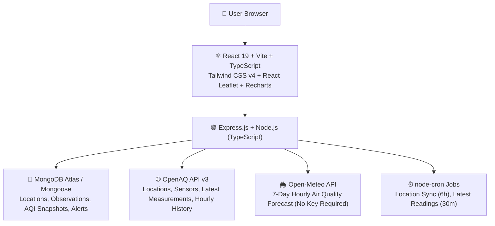

# BreatheBetter — Real-Time Air Quality Intelligence Platform

> **Tagline:** Know Your Air. Protect Your Health.  
> **Challenge:** Lets Code Diwali Challenge 2026 — Breathe Better  
> **Scope:** India-first, extensible to global locations  

---

## 🌟 Overview

**BreatheBetter** is a full-stack, production-quality Air Quality Intelligence Platform designed to monitor real-time air pollution across Indian cities and monitoring stations. 

Unlike basic dashboards that display raw numbers, BreatheBetter collects authentic air-quality measurements from **OpenAQ v3**, integrates 7-day modelled forecasts from **Open-Meteo**, computes mathematically verified AQI using **India's CPCB National AQI methodology**, tracks historical trends, and delivers actionable, public-health-grounded guidance.

---

## 🏗️ Architecture & Technology Stack



### Frontend
- **Framework:** React 19 with Vite & TypeScript
- **Styling:** Tailwind CSS v4 with dark mode & CPCB severity palette
- **Interactive Maps:** Leaflet & React Leaflet (vector CircleMarkers with CPCB colors)
- **Charts & Trends:** Recharts (PM2.5, PM10, NO₂, SO₂, CO, O₃)
- **State & Caching:** TanStack React Query + Zustand (with localStorage persistence)
- **Icons:** Lucide React

### Backend
- **Framework:** Node.js + Express.js with TypeScript
- **Database:** MongoDB Atlas via Mongoose (with in-memory fixture fallback mode)
- **Validation:** Zod schemas
- **External Providers:**
  - OpenAQ API v3 (`/locations`, `/latest`, `/sensors`, `/sensors/{id}/hours`)
  - Open-Meteo Air Quality Forecast API (7-day hourly projections)
- **Scheduler:** node-cron for recurring ingestion
- **Security:** Helmet, CORS, Express Rate Limiting (300 req / 15 min window)

---

## 📊 Features Implemented

| # | Feature | Details | Status |
|---|---|---|---|
| **1** | **Live AQI Dashboard** | Real-time CPCB AQI gauge, dominant pollutant, individual pollutant cards, freshness indicators, and health recommendations | ✅ Complete |
| **2** | **Interactive 2D Map** | Leaflet map of India with CPCB severity-colored markers, station popups, category filters, and geolocation | ✅ Complete |
| **3** | **Historical Pollution Tracker** | 24h, 7d, 30d time filters, multi-pollutant line charts, gap preservation (no interpolation) | ✅ Complete |
| **4** | **Location Comparison** | Compare up to 5 monitoring stations side-by-side without artificial cross-station averaging | ✅ Complete |
| **5** | **Health & Safety Dashboard** | Guidance on outdoor cardio, masks (N95/N99), ventilation, and vulnerable groups | ✅ Complete |
| **6** | **AQI Forecast (Open-Meteo)** | 7-day hourly forecast for PM2.5, PM10, NO₂, SO₂, CO, O₃ with distinct visual styling | ✅ Complete |
| **7** | **AI Air Quality Assistant** | Conversational assistant grounded in live station data & CPCB guidelines | ✅ Complete |
| **8** | **Smart AQI Alerts** | Create, update, and manage in-app threshold-based alerts per station | ✅ Complete |

---

## 📐 CPCB AQI Calculation Engine

The AQI engine strictly follows India's **Central Pollution Control Board (CPCB)** methodology:
1. Calculates pollutant-specific sub-indices using linear breakpoint interpolation.
2. Enforces minimum data completeness (16 of 24 hours for 24-hr averages).
3. Requires at least 3 valid sub-indices, of which **PM2.5 or PM10 is mandatory**.
4. AQI is determined by the **maximum sub-index** (`Dominant Pollutant`).
5. Unit tests cover all breakpoint boundaries (0, 30, 60, 90, 120, 250, 380, 500) and category transitions.

```bash
# Run backend AQI calculation unit tests
cd backend
npm test
```

---

## 🚀 Getting Started

### 1. Prerequisites
- Node.js >= 18 (Tested on v24.18)
- npm >= 9

### 2. Backend Setup
```bash
cd backend
npm install
npm run build
npm start # Or npm run dev for live reloading
```

The backend server runs on `http://localhost:5000`.

### 3. Frontend Setup
```bash
cd frontend
npm install
npm run dev
```

The frontend runs on `http://localhost:5173`. Requests to `/api/*` are automatically proxied to the backend.

---

## 🛡️ Data Authenticity & Licensing

- **OpenAQ:** Air quality observations and sensor metadata provided by OpenAQ under applicable open data licenses.
- **Open-Meteo:** Modelled air quality forecasts provided by Open-Meteo API under non-commercial CC BY 4.0. Modelled forecasts are clearly distinguished from ground observations.
- **CPCB Methodology:** AQI calculations are performed by BreatheBetter using CPCB formulas and breakpoints. Displayed with attribution: `"BreatheBetter AQI — Calculated using CPCB methodology"`.
- **OpenStreetMap:** Map tiles © OpenStreetMap contributors under ODbL.
